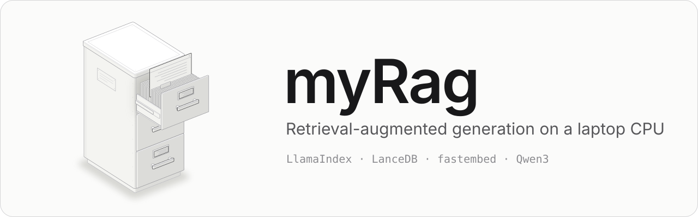

  <picture>
    <source media="(prefers-color-scheme: dark)" srcset="assets/banner-dark.svg">
    
  </picture>

myRag is a personal project to learn, demonstrate and test retrieval-augmented generation (RAG). It answers questions about a document collection with a small LLM that runs locally on a CPU-only laptop, and cites the passages it used.

The first corpus is the Spanish FastAPI documentation. Questions can be in Spanish or English.

## Status

Phase 1, a terminal MVP, is in progress. The [Phase 1 milestone](https://github.com/orb3gozo/myRag/milestone/1) tracks its issues, and [`PLAN.md`](PLAN.md) records the design and the three phases.

Setup and usage instructions arrive with #10, once the commands exist.

## The logo

The filing cabinet stands for the vector store. Each index card is a chunk of a document, and the lifted card is the one retrieval pulls out for a question. `just brand` rebuilds the SVG files in `assets/` from `assets/src/build.mjs`.
